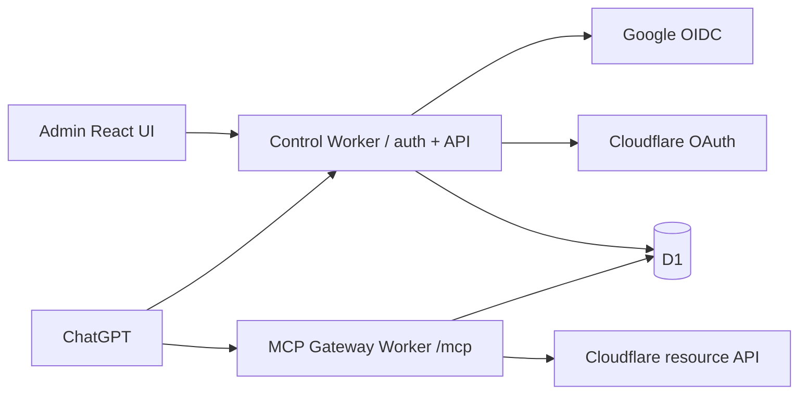

# Gem Cloudflare Manager

Plugin MCP multi-user/multi-account cho Cloudflare, TypeScript + Hono + React + Workers + D1. Repo triển khai MVP ứng viên; **chưa nghiệm thu OAuth/ChatGPT hoặc DNS trên tài khoản thật, chưa deploy staging/production**.

## Có gì trong code

- Google OIDC login (issuer/audience/nonce/verified email), cookie phiên HttpOnly.
- Authorization server riêng cho MCP: consent trong browser, Authorization Code + S256 PKCE, opaque bearer token lưu hash, resource/audience và expiry kiểm tra mỗi request. Google ID token không phải MCP token.
- Nhiều Cloudflare connection/account, identity confirmation, alias, lab/production, reconnect đúng subject, revoke độc lập, credential AES-256-GCM gắn connection ID + key version.
- Workspace invitation theo Google email đã xác minh, role và explicit per-account read/DNS grants. Role không mở quyền credential của người khác. Invitation trong ứng dụng; không tự gửi email.
- MCP: `whoami`, `list_connections`, `list_accounts`, `list_zones`, `list_dns_records`, `list_workers`, `list_d1_databases`, `list_tunnels`, `preview_dns_change`, `apply_operation`, `get_operation_status`.
- DNS create/update A/AAAA/CNAME/TXT/MX: preview bất biến, TTL approval 10 phút, đúng actor, production target confirmation, kiểm tra quyền/dữ liệu lại, claim nguyên tử, lock target xuyên connection, đọc lại upstream. Replay chỉ reconcile, không gửi lại write.
- Sáu màn hình quản trị và audit đã loại credential. API chỉ trả trường inventory được allowlist; không cache dữ liệu/quyền. Pagination 50, tối đa 4 request upstream đồng thời mỗi connection; 429 trả lỗi có kiểm soát để caller chờ rồi retry read.

## Chạy local

Yêu cầu Node 22+, npm. Từ root repo:

```sh
npm ci
npm run db:local
npm run build
npm run dev
```

Điền cấu hình OAuth trong `wrangler.jsonc`; tạo `.dev.vars` theo [hướng dẫn cấu hình](docs/OPERATIONS.md). Không đưa secret vào Git. Google callback local: `http://localhost:8787/auth/google/callback`; Cloudflare callback: `http://localhost:8787/auth/cloudflare/callback` (nhà cung cấp có thể yêu cầu URL HTTPS staging).

```sh
npm run check
npx playwright install --with-deps chromium
npm run test:e2e
```

E2E dùng D1 fixture tách riêng `.wrangler/e2e`, không gọi tài khoản Cloudflare. `npm run types` tái sinh binding types từ Wrangler. `npm run format:check` kiểm tra định dạng.

## Kiến trúc



`apps/control` chứa UI, OIDC/OAuth, sharing, approvals và audit. `apps/gateway` chứa MCP transport/tools; `packages/core` chứa policy, credential lifecycle, API adapter và operation engine. Local chạy chung một Worker để dùng một origin và dễ kiểm thử. Có entrypoint/config riêng `wrangler.gateway.jsonc` để deploy hai service: route chính xác `/mcp` tới gateway; các đường dẫn còn lại tới control cùng domain. Hai service dùng cùng D1, origin và credential keyring; không gọi vòng qua public endpoint của nhau.

## Đóng gói và phát hành

[Plugin package](plugin/plugin.json) và [MCP config](plugin/mcp.json) theo Agent Plugins 1.0.0; thay URL `.invalid` trước khi cài. Plugin skill hướng dẫn chọn target và xử lý approval/uncertainty. ChatGPT cần đăng ký custom MCP, nhập endpoint và OAuth client đã cấu hình; technical connector ID chỉ có sau khi đăng ký thật. Repo không giả lập ID này.

- [Triển khai, onboarding, rotation, backup/recovery](docs/OPERATIONS.md)
- [Ma trận nghiệm thu và việc cần kiểm chứng thật](docs/ACCEPTANCE.md)
- [Giới hạn và quyết định bảo mật](docs/SECURITY.md)

CI chạy typecheck, unit/integration/security, build, schema validation, browser E2E, format và npm audit. Không tự deploy hoặc thay đổi Cloudflare account khi push.

## Ngoài phạm vi

Chưa có arbitrary SQL/JavaScript, billing, IAM, bulk delete, Workers deploy/rollback, Tunnel mutation hoặc batch write. Chưa tuyên bố vừa gói Free: cần đo request, D1 reads/writes và CPU trên staging. Bước kiểm chứng tích hợp giai đoạn 0 vẫn là cổng phát hành bắt buộc; mock/local test không thay thế hai user, hai danh tính Cloudflare và ba account thật.
